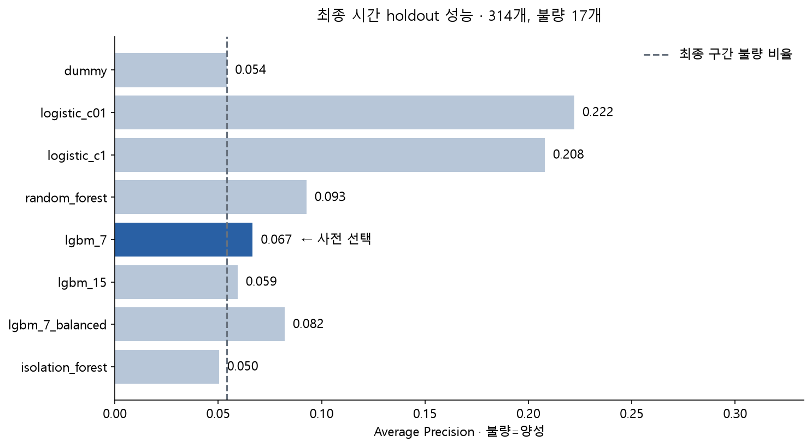
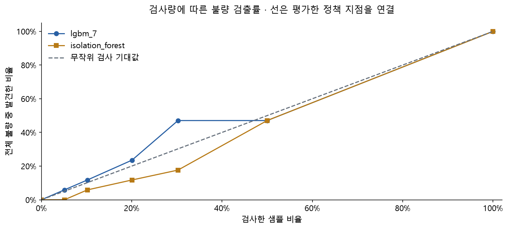
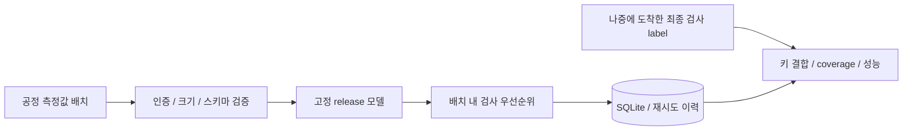

# SECOM Quality Lab

**반도체 불량 예측을 검사 자원 배분 문제로 연결하고, 시간 검증의 실패까지 공개한 ML 시스템 프로젝트.**

Leakage-aware semiconductor defect ranking with temporal validation, inspection budgets, and an authenticated local shadow-inference API.

> 상태: **shadow 운영 검증용**. 현재 모델은 생산 품질 판정에 승인되지 않았습니다.
> 모델 성능의 한계와 서비스 구현의 검증 범위를 구분합니다.

## 프로젝트에서 해결한 질문

검사할 수 있는 물량이 제한되어 있다면 어떤 생산 샘플부터 검사해야 할까?
모델 정확도만 제시하지 않고 데이터 누수 방지, 검사량별 불량 검출률, 오류 비용, 운영 재시도와 장애 대응까지 구현했습니다.

| 분야 | 구현 |
|---|---|
| 데이터 | 결측·상수·label·timestamp·중복 검사, SHA-256 출처 검증 |
| 모델 | Logistic Regression, Random Forest, LightGBM, Isolation Forest |
| 평가 | 5-fold × 3 seed 개발 검증, 마지막 시점 holdout, 검사 예산·비용 시나리오 |
| 운영 | FastAPI, 토큰 인증, 엄격한 입력 검증, SQLite 기반 재시도·동시성 제어 |
| 변경 관리 | 모델·스키마·기준 분포를 묶은 immutable release와 무결성 검사 |
| 관측 | 결측/범위 변화 경고, 호출 지연·오류 지표, 지연 label 결합·coverage |

## 주요 결과: 시간 일반화의 한계를 발견

| 측정 | 결과 |
|---|---:|
| 데이터 | 1,567개 샘플 / 590개 측정 변수 / 불량 104개 |
| 개발에서 선택한 모델 | LightGBM (`lgbm_7`) |
| 개발 반복 OOF AP 평균 | 0.1908 |
| 마지막 시점 holdout AP | 0.0666 |
| holdout 불량 비율 | 0.0541 |
| 상위 10% 정책의 검사량 | 32 / 314개 |
| 발견한 불량 | 2 / 17개 |
| 같은 검사량의 무작위 기대 발견 수 | 1.73개 |



개발에서 선택한 모델의 미래 시점 성능은 충분하지 않았습니다. 최종 평가에서 더 높은 AP를 보인 다른 모델로
선택을 바꾸지 않고, 시간별 성능·센서 분포 변화를 추가 진단했습니다. **1.15배 lift를 수율 개선 성과로 주장하지 않습니다.**



## 읽는 순서

1. [문제·원인·해결 방법·선택 이유](docs/ENGINEERING_LOG.md)
2. [운영 매뉴얼과 장애 대응](docs/OPERATIONS.md)
3. [선행연구와 실제 구현의 구분](docs/RESEARCH_MAP.md)
4. [면접 설명과 예상 질문](docs/INTERVIEW_GUIDE.md)
5. [실행 가능한 분석 노트북](notebooks/01_secom_quality.ipynb)

노트북은 GitHub에서 가볍게 읽을 수 있도록 출력 없이 보관합니다. 관측 결과와 그림은 `results/`에 있으며,
로컬에서 아래 명령으로 실행된 노트북과 HTML을 재생성할 수 있습니다.

## 재현하기 · Windows / Python 3.12

```powershell
git clone https://github.com/KORTibetfox/secom-quality-lab.git
cd secom-quality-lab
./setup.ps1
./.venv/Scripts/python.exe src/download_data.py
./run.ps1 -Action test
./run.ps1 -Action verify
./run.ps1 -Action notebook
```

Python 없이 Codex 번들 runtime만 있는 경우에도 `setup.ps1`이 이를 탐색합니다.
정확한 실험 패키지 버전은 [requirements-lock.txt](requirements-lock.txt)에 고정되어 있습니다.
제공 모델은 신뢰한 이 저장소의 release만 로드해야 하며 임의의 외부 joblib 파일을 사용하지 않습니다.

전체 재학습은 아래 순서로 수행합니다. 기존 결과와 모델을 갱신하므로 별도 작업 복사본을 권장합니다.

```powershell
./run.ps1 -Action train
./run.ps1 -Action diagnose
./run.ps1 -Action notebook
./run.ps1 -Action verify
```

## API 실행

```powershell
./run.ps1 -Action serve
# 별도 터미널
./run.ps1 -Action api-demo
```

서비스는 `127.0.0.1:8766`에만 바인딩합니다. 토큰과 SQLite DB는 처음 실행할 때 `state/`에 생성되며 Git에서 제외합니다.
입력은 unit ID와 590개 센서값으로 구성되고, 출력은 **보정되지 않은 순위 점수**와 `shadow_priority`입니다.
서비스가 검사 생략·출하 승인을 지시하지 않습니다. 자세한 계약은 [운영 문서](docs/OPERATIONS.md)에 있습니다.



## 검증 증거

- [운영·데이터 테스트 16개](results/operations_test_report.txt): 실제 HTTP, 동시 재시도, DB 잠금, 포화, 손상 모델 검출 포함.
- [로컬 HTTP 30회 측정](results/operations_smoke.json): 20행 배치의 warm p95 약 32ms. 단일 PC의 직렬 실측이며 생산 SLA가 아닙니다.
- [결과 대조](results/validation.json): 원본 해시·시간 분리·지표·검사량·비용·저장 모델 대조.
- [데이터 감사](results/data_audit.json), [프로토콜](results/protocol.json), [모델 카드](models/model_card.json).

이 측정은 2026-10-22 로컬 실행 기록입니다. 원격 CI 실행 상태와 혼동하지 않습니다.

## 저장소 구조

```text
src/          학습, 추론 API, 데이터 다운로드, 결과 검증
notebooks/    분석 노트북
results/      실제 측정 지표, 예측, 그림, 검증 기록
models/       실험 모델과 모델 카드
releases/     고정된 shadow release와 active pointer
tests/       데이터·계산·HTTP 운영 테스트
docs/        문제 해결 기록, 운영·면접·연구 문서
```

원본 데이터·MLflow 실행 폴더·캐시·개인 경로·인증 토큰·운영 DB는 Git에 올리지 않습니다.
`download_data.py`는 UCI 원본을 내려받아 실험 당시 해시와 대조합니다. 로컬 `mlruns/`는 재학습 시 생성됩니다.

## 한계와 후속 작업

2008년 공개 데이터이고, 센서는 익명이며 장비/lot ID와 입력 가용 시점이 확인되지 않았습니다.
불량 17개인 시간 holdout 한 구간만으로 현장 성능을 보장할 수 없습니다.
현장 적용에는 최근 데이터의 lot·장비·시간 분리 검증, 실제 비용 산정, shadow 관찰과 품질 담당자의 승인이 필요합니다.
TabPFN·TabM·VAE–SHAP는 선행연구 기반 후속 후보이며 이번에 재현했다고 주장하지 않습니다.

AI 지원을 받아 구현한 프로젝트입니다. 구현·관측 사실·확장 계획을 구분하고 실패한 실험 결과도 남겼습니다.

## 데이터 출처

McCann, M. & Johnston, A. (2008). **SECOM**. UCI Machine Learning Repository.
[DOI](https://doi.org/10.24432/C54305) · [CC BY 4.0](https://creativecommons.org/licenses/by/4.0/)

데이터에는 정상/불량 label 재코딩과 익명 센서 이름 부여를 적용했습니다. 원본 데이터의 저작권과 라이선스는
프로젝트 코드와 구분됩니다. [NOTICE](NOTICE.md)를 참고하세요.
